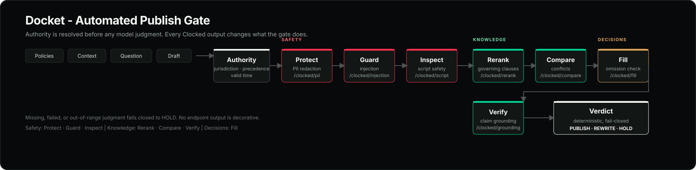

# docket ⚡

**A publish gate for service-desk knowledge and AI assistants.**

[](https://clocked.rezolve.ai/challenge)
[](https://clocked.rezolve.ai)
[](https://www.python.org/)
[](#tech-stack)
[](#run-tests)
[](LICENSE)
[](https://docket-clocked.vercel.app)
[](https://docket-clocked.vercel.app/console)

<p align="center">
  
</p>

---

## Overview

When an AI service-desk assistant drafts an answer from internal company documentation, how do you verify that it cited the active, legally governing policy rather than an outdated or regional document?

**Docket** is an automated publish gate that sits between your assistant and the employee. Given the candidate policy documents, the employee's context, the question, and the draft answer:

1. **Protects the Record:** Clocked Protect finds and replaces personal data before the audit preview is written.
2. **Resolves Document Authority:** Deterministically identifies which currently effective policy governs (jurisdiction, precedence, effective date, expiry).
3. **Screens the Sources:** Clocked Guard checks the policies and draft for prompt injection before any downstream model reads them.
4. **Selects the Governing Text:** Clocked Rerank picks the clauses that answer the question and skips superseded text.
5. **Surfaces Clause-Level Conflicts:** Clocked Compare pinpoints exact discrepancies between governing and superseded documents.
6. **Checks Completeness:** Clocked Fill extracts material obligations and judges whether the draft omits a condition or exception.
7. **Verifies Every Assertion:** Clocked Verify checks every claim in the draft against the governing document.
8. **Gates the Response:** Returns an actionable verdict — **Publish**, **Rewrite**, or **Hold** — with citations, a case record, credits and latency.

---

## The Problem: Grounded in the Wrong Source

Most critical AI service-desk failures are not pure hallucinations. The answer is **fluent, cited, and grounded in the wrong source**:

- **Precedence over Recency:** Traditional search algorithms assume the newest document wins. But in legal and enterprise governance, an older regional addendum frequently overrides a newer blanket corporate policy.
- **Silent Supersession:** When Policy v5 updates receipt limits, an assistant can still retrieve Policy v4 and produce an answer that passes basic grounding checks, despite stating invalid figures.
- **Jurisdiction Mismatch:** A policy written for US contractors is surfaced to a French full-time employee.

Standard RAG evaluators cannot catch this because the answer is 100% faithful to the retrieved passage.

### The 8 Questions Docket Asks

Before any answer is published to an employee, Docket resolves eight questions:

| # | Question | Answered By | How |
|---|---|---|---|
| **1** | Does the audit preview contain personal data? | **Clocked Protect** (`/clocked/pii`) | Finds and replaces personal data before the admin-only preview is stored. The check runs on the original input; the record keeps only the redacted copy. |
| **2** | Is the source trying to take control? | **Clocked Guard** (`/clocked/injection`) | Screens policy text and the draft for instruction overrides, fabricated approvals, secret extraction, and tool misuse. A positive signal holds the answer before Rerank. |
| **3** | Which policy governs this employee? | **App Engine** (Deterministic) | Ranks documents by precedence, country specificity, effective date and expiry. Future-dated and expired documents cannot govern. Resolves ties into a **Hold**. No LLM call. |
| **4** | Which clause answers the question? | **Clocked Rerank** (`/clocked/rerank`) | Scans candidate clauses with authority constraints injected into instructions. Selects governing clauses (`use`/`expand`) and skips superseded ones. |
| **5** | Where do the policies disagree? | **Clocked Compare** (`/clocked/compare`) | Aligns governing clauses with superseded clauses to quote exact text discrepancies. |
| **6** | Does the draft omit a material condition? | **Clocked Fill** (`/clocked/fill`) | Extracts material obligations and returns a yes/no omission judgment plus the missing condition. A material omission forces **Rewrite**. |
| **7** | Does the draft claim only what the governing text supports? | **Clocked Verify** (`/clocked/grounding`) | Checks discrete sentence claims against the complete governing document for `supported`, `contradicted`, or `not_stated`. |
| **8** | What action must be taken now? | **App Policy** (Deterministic) | Enforces strict publication thresholds. Contradicted, unsupported, missing, or unverifiable claims and material omissions block release. |

> **Core Thesis:** Authority is a business rule; relevance is a model judgment.  
> Never delegate "which policy wins" to an LLM, and never let a model's relevance score bypass an explicit precedence rule.

---

## How Clocked is Used

Six Clocked endpoints across all three groups are load-bearing to Docket's
decision engine: Protect and Guard (safety), Fill (decisions), and
Rerank, Compare, and Verify (knowledge).

```
[ Policies + Context + Question + Draft ]
                    │
                    ▼
   Deterministic Authority Resolver (valid time)
                    │
                    ▼
     Clocked Protect (/clocked/pii)          → Redacts audit previews
                    │
                    ▼
     Clocked Guard (/clocked/injection)      → HOLD on injection / prompt takeover
                    │
                    ▼
     Clocked Rerank (/clocked/rerank)        → Selects governing clause; skips old text
                    │
                    ▼
     Clocked Compare (/clocked/compare)      → Aligned clause comparison for conflicts
                    │
                    ▼
     Clocked Fill (/clocked/fill)            → Extracts obligations; finds omissions
                    │
                    ▼
     Clocked Verify (/clocked/grounding)     → Claim-by-claim grounding against truth
                    │
                    ▼
        Deterministic Verdict Policy         → PUBLISH / REWRITE / HOLD
```

### Empirical Design Discoveries

1. **Compare is strictly clause-level:** Passing whole multi-page documents to Compare caused false conflicts and cost 584 credits per call. Docket segments documents first and aligns clauses based on token overlap and structural position, reducing cost to ~5 credits per check with exact quotes.
2. **Rerank needs authority rules in instructions:** Rerank excels at semantic relevance but cannot guess organizational hierarchy. Docket resolves authority first, then passes the governing rule directly in the `instructions` payload so superseded clauses are explicitly skipped.
3. **Verify checks the full governing document:** While Rerank isolates the primary clause answering the question, drafts often mention secondary requirements (e.g., receipt thresholds or delivery dates). Verify inspects the full governing text to ensure every claim is grounded.
4. **Guard belongs before Rerank:** Policy documents and the draft are untrusted input. Guard catches an instruction override before it can influence retrieval or verification; the check returns **HOLD** and cites the risky passage.
5. **Protect belongs before the record:** The audit preview is useless if it leaks the employee's email or bank account. Protect redacts the preview while the check still runs on the original text.
6. **Completeness is a separate check:** Verify catches wrong claims, not missing ones. Fill extracts the material obligations and returns an omission judgment, so a draft cannot pass by saying less.
7. **Zero claims are not a pass:** If Verify returns no countable claims, a missing support score, or an unknown claim verdict, Docket holds or rewrites rather than publishing on an empty result.

---

## Verdict Decision Rules

| Verdict | Trigger Condition | Outcome |
|:---:|---|---|
| **`HOLD`** | Prompt injection in the source or draft, ambiguous authority tie, no currently effective governing document, no governing clause found, no countable Verify claims, a missing support score, a missing coverage judgment, an internal contradiction, or an upstream/channel failure. | Publish blocked. Escalated to a human reviewer. |
| **`REWRITE`** | Any counted claim is contradicted, any counted claim is not supported (`not_stated`, `partial`, unknown), a material policy condition is omitted, or overall groundedness $< 50\%$. | Publish blocked. Contradicted claims struck through with governing quotes; omitted conditions listed. |
| **`PUBLISH`** | 100% of counted claims are verified and supported, the coverage check finds no material omission, the support score is numeric and in range, and there is no internal conflict. | Cleared for automated delivery. |

---

## Live Scenarios

Docket includes five built-in reference cases tested live against Clocked:

* **Precedence over Recency (Flagship Case):** An employee in France asks if monitor reimbursement requires manager approval. Global Policy v4 (June 2026, precedence 0) requires approval; France Annex (March 2026, precedence 1) waives approval. Docket identifies France Annex as governing despite being older, rejects the draft, and returns **`REWRITE`**.
* **Version Supersession:** Expense Policy v5 updates receipt limits to \$50 and deadlines to 60 days. The assistant draft cites v4 limits (\$75 / 30 days). Docket catches the discrepancies and returns **`REWRITE`**.
* **Clean Access Request (Control Case):** An access request policy requires manager approval and security training. The draft accurately states both conditions. Docket returns **`PUBLISH`**.
* **Omitted Condition (Completeness Case):** A remote-work policy allows remote work but requires customer-facing employees on-site. The draft states the general rule and omits the exception. Clocked Fill finds the omission and returns **`REWRITE`**.
* **Injected Policy Note (Safety Case):** A policy document contains an instruction aimed at the assistant. Clocked Guard detects it before Rerank and returns **`HOLD`**.

---

## API Reference

### `POST /api/check`
Synchronous endpoint returning full JSON evaluation, authority traces, claim statuses, and Clocked metrics.

```bash
TOKEN=$(curl -s https://docket-clocked.vercel.app/api/session \
  | python3 -c 'import json,sys; print(json.load(sys.stdin)["token"])')

curl -s https://docket-clocked.vercel.app/api/check \
  -H "X-Docket-Session: $TOKEN" \
  -H 'Content-Type: application/json' \
  -d '{
    "question": "Does an employee in France need approval to expense a monitor?",
    "draft": "Monitor reimbursement requires prior manager approval.",
    "country": "FR",
    "documents": [
      {
        "title": "Global policy",
        "jurisdiction": "Global",
        "effective_date": "2026-06-01",
        "precedence": 0,
        "text": "Monitor reimbursement requires prior manager approval."
      },
      {
        "title": "France annex",
        "jurisdiction": "FR",
        "effective_date": "2026-03-01",
        "precedence": 1,
        "text": "For employees in France, monitor reimbursement does not require prior manager approval."
      }
    ]
  }'
```

### Additional Endpoints
* `GET /api/session`: Issues a signed, short-lived browser session token. The console calls this automatically.
* `POST /api/check/stream`: Real-time Server-Sent Events (SSE) stage progress and final determination. The console uses this route.
* `GET /api/samples` · `GET /api/samples/{id}`: Reference test cases.
* `GET /api/checks`: Admin-only preview log. Requires `X-Docket-Admin` matching `DOCKET_ADMIN_TOKEN`; returns 404 otherwise.
* `GET /api/stats`: Aggregate credit usage, latency, and verdict counts.
* `GET /api/health`: Health status and Clocked API configuration check.

`POST /api/check` and `/api/check/stream` require either the signed session token
(`X-Docket-Session`) or a bearer `DOCKET_API_TOKEN`. Set a stable
`DOCKET_SESSION_SECRET` in production so sessions survive across instances.

---

## Tech Stack

* **Backend:** Python 3.11+, [FastAPI](https://fastapi.tiangolo.com/), [Uvicorn](https://www.uvicorn.org/), [HTTPX](https://www.python-httpx.org/) (async client).
* **Web Surfaces:** Dual-route setup:
  - Landing & marketing overview served at `/` from `website/`.
  - Interactive case desk served at `/console` (built with semantic HTML5, modern CSS, and Vanilla JS with **zero build step and zero npm dependencies**).
* **Database:** SQLite with Write-Ahead Logging (`WAL`), running locally in development and `/tmp/docket.db` on serverless runtimes. On Vercel the preview log is per-instance and ephemeral; it is not an auditor-grade record.
* **Resilience:** Bounded retries with exponential backoff and jitter for 429/5xx, unique UUID `Idempotency-Key` headers on all Clocked requests, and strict fail-safe `HOLD` defaults.
* **Access control:** `/api/check` and `/api/check/stream` require a signed short-lived session from `GET /api/session` or a bearer `DOCKET_API_TOKEN`. `/api/checks` is admin-only.
* **Abuse controls:** Check routes are rate-limited per IP and by a daily demo budget; session issuance has its own per-IP limit.
* **Privacy:** Full policy texts exist only in memory during the check. The admin-only preview log stores truncated question previews ($\le 240$ chars) and draft previews ($\le 180$ chars).

---

## Quickstart

### Local Setup
```bash
# 1. Clone repository
git clone https://github.com/j4yop/docket.git
cd docket

# 2. Virtual environment & dependencies
python3 -m venv .venv && source .venv/bin/activate
pip install -r requirements.txt

# 3. Environment configuration
cp .env.example .env
# Set CLOCKED_API_KEY=... in .env

# 4. Start the server
uvicorn app:app --reload --port 8000
# Marketing: http://127.0.0.1:8000
# Gate Console: http://127.0.0.1:8000/console
```

### Run Tests
```bash
pip install -r requirements-dev.txt
python -m pytest -v
```
*39 unit tests cover authority resolution, valid-time/expiry handling, clause segmentation, date parsing, database path selection, coverage/omission policy, and verdict policies offline without requiring an API key.*

---

## Rubric Mapping

| Criterion | How Docket Delivers |
|---|---|
| **Practical Usefulness (25 pts)** | Directly solves the "grounded in the wrong source" failure mode for enterprise AI assistants. Provides automated gating with clear before/after replacement quotes. |
| **Core Clocked Integration (30 pts)** | All three Clocked endpoints (**Rerank**, **Compare**, **Verify**) are load-bearing to the business logic. |
| **Additional Endpoints (15 pts)** | Six meaningful endpoints across all three groups: Protect, Guard, Fill, Rerank, Compare, Verify. Each changes what the app stores, decides, or shows. Full group breadth and strong Best Overall breadth. |
| **Implementation & UX (20 pts)** | Responsive red/black console, real SSE stage progress, Protect/Guard/Coverage stages, interactive diffs, import/export. Axe checks pass on the shipped home and console. |
| **Explanation & Reproducibility (10 pts)** | Clean architecture, 39 offline unit tests, live Vercel deployment, transparent raw Clocked JSON inspect tabs. |

---

## Attribution and license

Docket's marketing page and console shell are original. Spline Sans and JetBrains Mono are self-hosted under the SIL Open Font License; the license texts are in `website/fonts/`. No third-party brand metadata, testimonials, blog posts, or social links remain in the served pages.

MIT License. See [LICENSE](LICENSE) for details.
