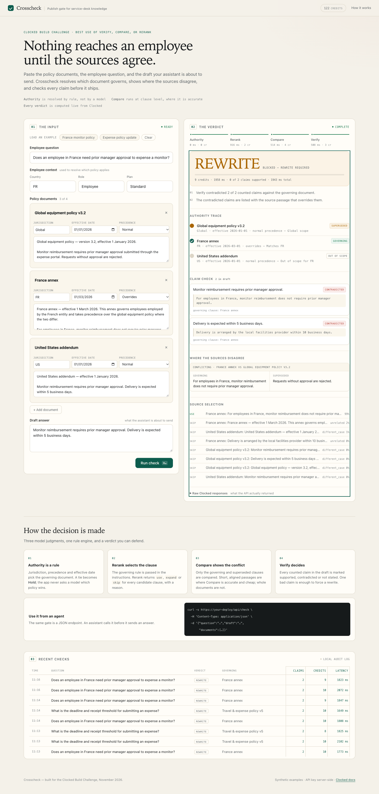

# Docket

**Nothing reaches an employee until the sources agree.**

**Live:** <https://docket-tau.vercel.app>

A publish gate for service-desk knowledge. Give it the policy documents, the employee
question, and the draft an AI assistant is about to send. It resolves which document
governs, shows where the sources disagree, checks every claim, and returns **Publish**,
**Rewrite**, or **Hold** — with citations.



Built for the [Clocked Build Challenge](https://clocked.rezolve.ai/challenge), November 2026.

---

## The problem

An AI assistant answers an employee from the knowledge base. The answer is fluent, cited,
and sometimes wrong — because the source it used is stale, superseded, or written for a
different country or plan. Nothing in the answer signals which.

The failure is not hallucination. It is **grounded in the wrong source**. Retrieval and
groundedness checks cannot catch it: a perfectly grounded answer can still cite a policy
that no longer governs.

- 76%+ of 143 founders, operators and engineers say they have watched an AI tool surface an
  outdated document and confidently produce a wrong answer (Slite, 2026 — vendor survey).
- Industry guides report 15–30% of knowledge articles conflict with another document.
- r/sre, May 2026: "every single runbook is either 2 years out of date or just doesn't exist."

## What the user does

1. Ask the employee question and set the context: country, role, plan.
2. Add up to four policy documents. Each has a jurisdiction, effective date, and an
   "overrides" flag. The examples are prefilled; every field is editable.
3. Paste the draft the assistant wants to send.
4. Run the check.

## What Docket does

| Step | Owner | Question | Output |
|---|---|---|---|
| 1 | **App** (deterministic) | Which document governs this employee? | Authority trace, or **Hold** on a tie |
| 2 | **Rerank** | Which clause answers the question? | `use` / `expand` / `skip` per clause, with reason |
| 3 | **Compare** | Where do the governing and superseded text disagree? | Conflicts with both passages |
| 4 | **Verify** | Does the draft claim only what the governing document supports? | Claim-level verdicts and a support score |
| 5 | **App** (deterministic) | What happens now? | **Publish**, **Rewrite**, or **Hold** |

### The verdict rule

| Condition | Verdict |
|---|---|
| Authority is ambiguous, no governing clause, or a check failed | **Hold** |
| Any counted claim is contradicted | **Rewrite** |
| Any counted claim is not stated in the governing document | **Rewrite** |
| Overall support below 50% | **Rewrite** |
| Every counted claim supported, no internal conflict | **Publish** |

## How Clocked is used

| Endpoint | When it runs | What its output changes |
|---|---|---|
| **Rerank** `/clocked/rerank` | Every check, after authority is resolved | Selects the governing clause. The authority rule is passed in `instructions`; a superseded clause is marked `different_case` and skipped. |
| **Compare** `/clocked/compare` | Only when a superseded document exists, and only on short aligned clauses | Produces the conflict evidence. A conflict is shown, not auto-blocked; the conflict does not override a clear authority rule. |
| **Verify** `/clocked/grounding` | Every check, against the whole governing document | Decides Publish vs Rewrite. Each counted claim is supported, contradicted, or not stated. |

All three endpoints are load-bearing. Remove Rerank and the app checks the draft against
the wrong policy. Remove Compare and the reviewer cannot see what changed. Remove Verify
and there is no decision.

## Design decisions that came from live testing

The app was pressure-tested on real documents before it was built. Three findings shaped it:

1. **Authority is a rule, not a model judgment.** Rerank does not infer that a regional
   annex overrides a global policy, even when the document says so. The app resolves
   authority from jurisdiction, precedence and effective date, then passes the rule to
   Rerank in `instructions`.
2. **Compare is only reliable at clause level.** On two short aligned clauses it is exact
   and cheap (5 credits, under a second). On full documents it produced false conflicts and
   cost 584 credits for one call. The app segments first and never sends a whole document.
3. **Verify needs the whole governing document.** Rerank selects the clause that answers
   the question; the draft may make claims about something else. Verify reads the full
   governing document (up to 50k characters) so every claim is checked.

## What is live, and what is not hardcoded

- Every verdict is computed from live Clocked responses. There are no stored decisions and
  no fixture the app depends on.
- The example corpus is input, not logic. Edit any field, delete a document, or paste your
  own text; the same pipeline runs.
- The claim table, conflict list, authority trace, credit count and latency all come from
  the current request.
- "Raw Clocked responses" shows exactly what the API returned for this run.
- Re-running the same input produces the same decision because the inputs are the same,
  not because the answer is cached.

## Run locally

```bash
python3 -m venv .venv && source .venv/bin/activate
pip install -r requirements.txt

cp .env.example .env
# set CLOCKED_API_KEY=... in .env

uvicorn app:app --reload --port 8000
# open http://127.0.0.1:8000
```

Python 3.11+. No frontend build step, no database server, no JS dependencies.

### Tests

```bash
pip install -r requirements-dev.txt
python -m pytest -q
```

19 tests cover the authority resolver, clause segmentation and the verdict policy. They run
without an API key.

## Deploy

The live demo runs on Vercel's native FastAPI support:

```bash
vercel link
vercel deploy --prod \
  --env CLOCKED_API_KEY=... \
  --env DOCKET_DB=/tmp/docket.db \
  --env DOCKET_STREAMING=0
```

`DOCKET_STREAMING=0` switches the UI to the JSON endpoint because serverless functions
do not stream reliably. Locally, the UI uses SSE for real stage progress. The Docker path
is also included:

```bash
docker build -t docket .
docker run --rm -p 8000:8000 -e CLOCKED_API_KEY=... docket
```

A `Procfile` is included for Render, Railway and Heroku-style platforms. On an ephemeral
filesystem the audit log resets on redeploy; that is acceptable for the demo.

## API

| Route | Purpose |
|---|---|
| `POST /api/check` | JSON check. Returns the full result. |
| `POST /api/check/stream` | Same check over SSE, with a `stage` event per step. |
| `GET /api/samples` · `/api/samples/{id}` | The three example inputs. |
| `GET /api/checks` | Recent audit rows (decisions and previews, not documents). |
| `GET /api/stats` | Totals: checks, credits, verdict counts. |
| `GET /api/health` | Key configured, streaming enabled. |

Example:

```bash
curl -s https://docket-tau.vercel.app/api/check \
  -H 'Content-Type: application/json' \
  -d '{
    "question": "Does an employee in France need approval to expense a monitor?",
    "draft": "Monitor reimbursement requires prior manager approval.",
    "country": "FR",
    "documents": [
      {"title":"Global policy","jurisdiction":"Global","effective_date":"2026-01-01","precedence":0,"text":"..."},
      {"title":"France annex","jurisdiction":"FR","effective_date":"2026-03-01","precedence":1,"text":"..."}
    ]
  }'
```

## Failure behaviour

| Failure | Behaviour |
|---|---|
| 402 credits / spend limit | **Hold**, with the stage and message |
| 409 idempotency conflict | **Hold**, no blind retry |
| 429 rate limit | Bounded retry with backoff and jitter, then **Hold** |
| 5xx / timeout | Bounded retry, then **Hold** |
| 400 / 422 | **Hold** with the endpoint's detail |
| Authority tie | **Hold** before any API call |
| No governing clause | **Hold** |
| No superseded document | Compare skipped; the decision still stands |
| Missing draft | Validation error; no API call |

Every retry reuses the same `Idempotency-Key` and payload. Each endpoint gets its own key.

## Privacy

The audit log stores the decision, credits, latency, document titles and a short draft
preview — not the full documents. Raw API responses are shown in the browser for the current
session. The API key lives in the server environment and never reaches the browser.

## Costs

Measured on the three examples, live:

| Case | Calls | Credits | Time |
|---|---|---|---|
| Clean access request | Rerank + Verify | 4 | ~0.6 s |
| France monitor policy | Rerank + Compare + Verify | 9–10 | ~1–2 s |
| Expense policy update | Rerank + Compare + Verify | 8–10 | ~1–2 s |

## Limitations

- **Text only in the UI.** The API supports PDFs; the demo keeps the input text-first for reliability.
- **Authority is explicit.** Jurisdiction, date and precedence are user-supplied. The app does not infer them from document content, because that is a business rule.
- **Compare is not an entailment engine.** It finds differences between aligned clauses; Verify checks whether a claim is supported.
- **A clean draft can still omit something.** Verify checks claims, not completeness.
- **Single-tenant demo.** No auth; do not put real employee data on the public instance.

## Rubric mapping

| Criterion | How the app earns it |
|---|---|
| Practical usefulness (25) | A named buyer, a documented failure, a blocked publish, and a measurable outcome |
| Core Clocked integration (30) | Rerank selects, Compare evidences, Verify decides; each is load-bearing |
| Additional endpoints (15) | 3/3 in Verify, Compare, Rerank; Compare is skipped when there is only one source |
| Implementation / UX (20) | A clear desk, real stage progress, citations, keyboard and mobile support |
| Explanation / reproducibility (10) | README, architecture, 19 tests, failure table, raw JSON |

## Layout

```
app.py             FastAPI routes, SSE, scan orchestration
clocked_client.py  auth, idempotency, bounded retries, error classes
authority.py       clause segmentation, authority resolver, clause alignment (pure)
policy.py          verdict logic and claim splitting (pure)
db.py              SQLite audit log, previews only
samples.py         three editable example inputs
static/            index.html, app.css, app.js (no build step)
tests/             authority and policy tests
```

## Third-party code

No framework beyond FastAPI, Uvicorn and HTTPX. The frontend is hand-written HTML, CSS and
JavaScript with no dependencies. All example content is synthetic.

## What I would do with another week

- PDF input through Clocked's PDF mode, with the same gate.
- A conflict register that persists across checks and shows age and owner.
- A rewrite assistant that proposes the corrected sentence from the governing clause.
- Auth and per-tenant keys for a real deployment.
